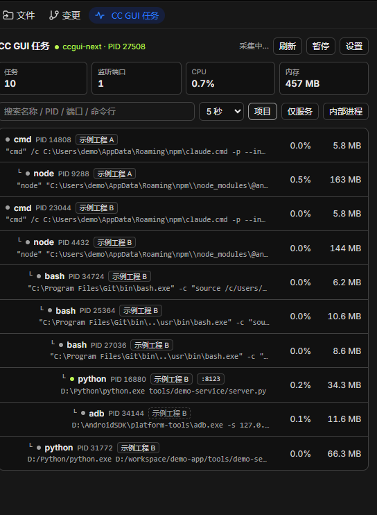
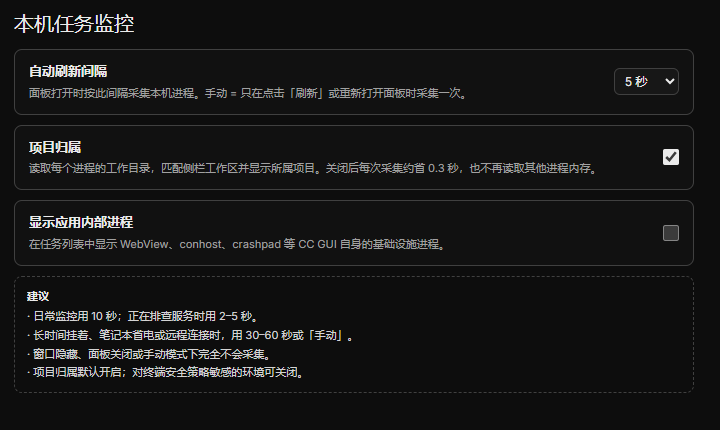

# 本机任务监控

在 CC GUI 右侧面板里查看**由 CC GUI 启动并管理的本机进程与任务**：进程树、所属项目 / 工作区、PID、监听端口、CPU、内存与运行时长。

只读监控：不会结束进程、不会修改任何任务，也不会联网上报数据。





> 截图中的项目名与路径是脱敏后的示例数据。

## 功能

- **进程树**：以 `ccgui-next` 主进程为根，递归列出所有子孙进程，层级缩进 + 连接线展示父子关系
- **项目归属**：读取每个进程的工作目录（PEB，只读），匹配 CC GUI 侧栏工作区后显示所属项目；cwd 不命中时沿父进程链继承（例如系统目录里的 adb），继承来源用虚线徽标区分
- **监听端口**：解析 `netstat -ano`，标出每个进程正在监听的 TCP 端口；有监听端口的进程显示绿色状态点
- **资源占用**：CPU 百分比（按进程 CPU 时间差推算）、工作集内存、运行时长
- **搜索**：按名称 / PID / 端口 / 命令行 / 项目过滤
- **仅服务**：只显示有监听端口的进程
- **配置**：自动刷新间隔（手动 / 2 / 5 / 10 / 30 / 60 秒）、项目归属开关、内部进程开关，面板与设置页双向同步
- **手动模式**：完全不轮询，只在点击「刷新」或重新打开面板时采集一次

仅支持 Windows 10 / 11（依赖 PowerShell、CIM 与 Win32 API）。

## 配置与建议

| 配置 | 选项 | 默认 | 建议 |
|---|---|---|---|
| 自动刷新间隔 | 手动 / 2 / 5 / 10 / 30 / 60 秒 | 5 秒 | 日常挂机 10 秒；排查端口冲突或进程异常时 2–5 秒；长期挂机 / 省电 / 远程桌面用 30–60 秒或手动 |
| 项目归属 | 开 / 关 | 开 | 建议开启；它会读取进程工作目录，强 EDR 管控或对进程内存读取敏感的环境可关闭 |
| 显示应用内部进程 | 开 / 关 | 关 | 保持关闭，只看任务主体；核对 CC GUI 自身基础设施时临时打开 |

关闭项目归属后，采集脚本会跳过内嵌 C# 编译与 PEB 读取，单次采集约从 1.7 秒降到 1.4 秒。

## 安装

- 市场：CC GUI → 插件 → 搜索「本机任务监控」→ 安装（上架后可用）
- 本地：CC GUI → 插件 → 从本地目录安装 → 选择本仓库根目录（含 `manifest.json` 的那一层）

## 权限说明

| 权限 | 用途 |
|---|---|
| `ui:panel-tab` | 在右侧面板注册「CC GUI 任务」页签 |
| `ui:settings-section` | 提供插件设置页，并支持从面板直接跳转 |
| `exec:powershell` | 运行一次只读 PowerShell 采集脚本（进程列表、端口、CPU 时间） |
| `host:workspace` | 读取侧栏工作区列表，用于把进程工作目录匹配到所属项目 |
| `storage` | 在本机插件私有 KV 中保存刷新间隔与开关 |

没有网络权限：插件不发起任何网络请求。

## 工作原理

1. 通过 `powershell` 一次性采集：`Get-CimInstance Win32_Process` 取进程树 / 命令行 / CPU 时间，`netstat -ano -p TCP` 取监听端口。
2. 项目归属开启时，在同一个 PowerShell 进程里用内嵌 C# 经 PEB 读取每个进程的当前工作目录（`NtQueryInformationProcess` → PEB → `CurrentDirectory.DosPath`），只读。
3. JS 侧用 `ctx.workspaces.list()` 的工作区路径做最长前缀匹配；未命中的进程沿父进程链继承归属。
4. 面板按进程树排序渲染；窗口隐藏、面板关闭或手动模式下不采集。

采集是一次性的子进程调用，不会常驻后台服务。

## 系统影响

- 每次采集约 1.4–1.8 秒（PowerShell 启动占大头），峰值内存约 100–110 MB（PowerShell 进程，采集结束即释放）
- 默认 5 秒间隔约 30% 占空比；10 秒约 15%；手动模式为 0
- 项目归属会读取每个子孙进程的工作目录，可能触发部分终端安全 / EDR 的进程内存访问告警；关闭该开关即可完全跳过
- 无网络、无遥测、无持久化后台任务

## 隐私与安全

- 所有数据只在本机内存与本机插件存储中处理，不上传、不记录、不外发
- 进程命令行可能包含本机路径或参数，仅显示在当前面板；项目归属开关关闭后不读取工作目录
- 插件只读：不结束进程、不写文件、不改系统配置

## 开发

仓库结构：

```
.
├── manifest.json              # 插件清单（id / 版本 / 权限 / 展示素材）
├── src/main.js                # 单文件 ESM 源码（无 import / JSX）
├── build.mjs                  # 构建：src/main.js → dist/main.js，校验黑名单与体积
├── .github/workflows/release.yml  # 推送 tag 时构建并附加 Release 附件
├── docs/                      # 图标与截图
├── README.md
└── LICENSE
```

本地构建与自检：

```bash
node build.mjs
```

本地调试：改 `src/main.js` 后重新执行 `node build.mjs`，再在 CC GUI「插件 → 从本地目录安装」选 `dist/`（或本仓库根目录）热重载。

## 发版

1. 修改 `manifest.json` 与 `src/main.js` 里的版本相关逻辑，`version` 必须严格递增。
2. 提交并推送，打与 `version` 完全一致的 tag（不带 `v` 前缀）：

   ```bash
   git tag 0.3.1
   git push origin 0.3.1
   ```

3. GitHub Action 自动构建并把 `main.js`、`manifest.json`、`checksums.txt` 附加到该 tag 的 Release。
4. 已上架版本：向索引仓 `zhukunpenglinyutong/ccgui-plugins` 提交「版本登记 PR」或在插件仓库发 Release 后等待索引机器人自动登记。

## 许可证

[MIT](LICENSE)
